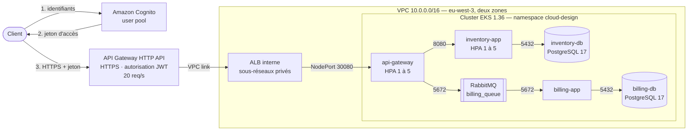
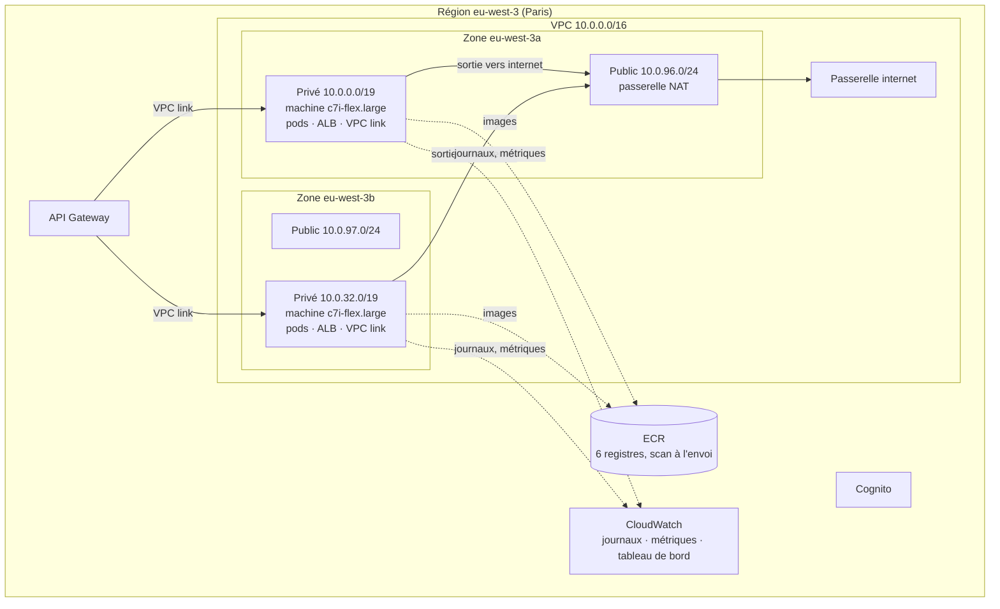
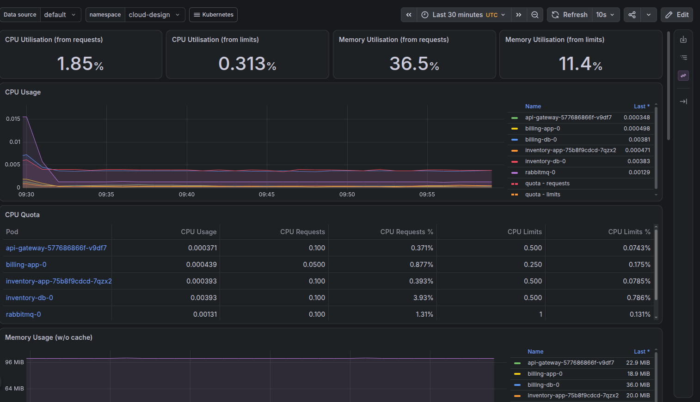
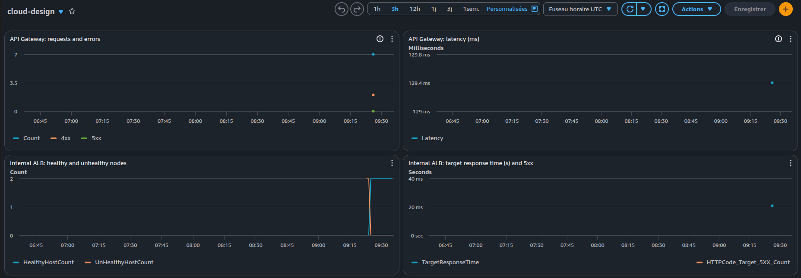

# cloud-design — Microservices sur AWS (EKS, Terraform)

**Auteur :** `clecart` — **Région :** `eu-west-3` (Paris) — **Pile :** Terraform 1.16.6
(fournisseur AWS 6.69.1, modules VPC 6.7.3 et EKS 21.29.0) · Amazon EKS 1.36 · Helm 4.3.1 ·
kubectl 1.36.4 · AWS CLI 2.38.2 · Docker 29.9

Ce document est à la fois le **compte-rendu** du projet et sa **documentation complète** :
architecture, coûts, prérequis, installation, utilisation, sécurité, surveillance,
autoscaling, scénario d'audit, choix techniques et dépannage. Les résultats cités ont été
mesurés sur l'infrastructure réellement construite depuis ce dépôt (séances des 20 et
21 octobre 2026). La préparation du jeu de rôle de l'audit est dans
[REVISION-AUDIT.md](REVISION-AUDIT.md).

> **Démarrage rapide** — prérequis : un compte AWS, l'AWS CLI configurée, Terraform,
> kubectl, Helm et Docker ([§1](#1-prérequis)).
>
> ```bash
> git clone https://zone01normandie.org/git/clecart/cloud-design.git && cd cloud-design
>
> # Une seule fois : registres d'images + Cognito, puis les 6 images
> terraform -chdir=terraform/persistent init && terraform -chdir=terraform/persistent apply
> Scripts/push-images.sh
>
> # À chaque séance de travail
> cp terraform/platform/terraform.tfvars.example terraform/platform/terraform.tfvars  # y mettre son IP
> terraform -chdir=terraform/platform init && terraform -chdir=terraform/platform apply  # ~11 min
> Scripts/deploy.sh                                                                     # ~2 min
> API_TOKEN="$(Scripts/api-token.sh)" \
>   GATEWAY_URL="$(terraform -chdir=terraform/platform output -raw api_url)" \
>   Scripts/test-api.sh                                                                 # 16 vérifications
> Scripts/teardown.sh   # fin de séance : tout détruire, puis inventaire des 17 régions
> ```
>
> Une plateforme allumée coûte environ **0,38 $ de l'heure** ([§2](#2-coûts-et-maîtrise-des-dépenses)) :
> `Scripts/teardown.sh` termine **chaque** séance.

---

## Sommaire

0. [Vue d'ensemble](#0-vue-densemble)
1. [Prérequis](#1-prérequis)
2. [Coûts et maîtrise des dépenses](#2-coûts-et-maîtrise-des-dépenses)
3. [Organisation du dépôt](#3-organisation-du-dépôt)
4. [Installation et démarrage](#4-installation-et-démarrage)
5. [Utilisation](#5-utilisation)
6. [Architecture détaillée](#6-architecture-détaillée)
7. [Sécurité](#7-sécurité)
8. [Surveillance et journaux](#8-surveillance-et-journaux)
9. [Autoscaling et tests de charge](#9-autoscaling-et-tests-de-charge)
10. [Scénario d'audit pas à pas](#10-scénario-daudit-pas-à-pas)
11. [Choix techniques et alternatives](#11-choix-techniques-et-alternatives)
12. [Dépannage : problèmes rencontrés](#12-dépannage--problèmes-rencontrés)

---

## 0. Vue d'ensemble

### 0.1 Ce que fait le projet

L'application de microservices des projets `crud-master`, `play-with-containers` et
`orchestrator` (code repris de ma propre solution `orchestrator`) est déployée sur AWS :

| Composant | Rôle | Port |
|---|---|---|
| `api-gateway` | Point d'entrée : relaie `/api/movies` vers inventory-app, publie `/api/billing` dans RabbitMQ | 3000 |
| `inventory-app` | API REST des films (CRUD) | 8080 |
| `inventory-db` | PostgreSQL 17, base `movies` | 5432 |
| `billing-app` | Consomme la file `billing_queue` et enregistre les commandes | 8080 |
| `billing-db` | PostgreSQL 17, base `billing_db` (table `orders`) | 5432 |
| `rabbitmq` | Courtier de messages (file durable `billing_queue`) | 5672 |

Autour de l'application, le projet construit et documente :

- l'infrastructure AWS en **Terraform** (réseau sur deux zones, cluster EKS, load balancer
  interne, API Gateway, Cognito, registres ECR, journaux et tableau de bord CloudWatch) ;
- une **entrée publique HTTPS** protégée par une **authentification gérée** (Cognito) ;
- la **surveillance** (Prometheus + Grafana) et les **journaux** (Fluent Bit → CloudWatch Logs) ;
- l'**autoscaling** des services (HorizontalPodAutoscaler) et des machines (Cluster Autoscaler) ;
- l'**isolation réseau** entre services (NetworkPolicies) et le **chiffrement** des échanges ;
- la **maîtrise des coûts** : plan gratuit AWS, création et destruction à chaque séance,
  inventaire automatique des 17 régions.

### 0.2 Architecture





### 0.3 Composants AWS et leur rôle

| Service | Usage dans le projet | Défini dans |
|---|---|---|
| VPC, sous-réseaux, passerelle NAT | Réseau isolé sur 2 zones ; machines et bases dans les sous-réseaux privés | `terraform/platform/vpc.tf` |
| Amazon EKS | Cluster Kubernetes 1.36, 2 à 3 machines `c7i-flex.large` | `terraform/platform/eks.tf` |
| Elastic Load Balancing (ALB) | Load balancer **interne** devant api-gateway | `terraform/platform/alb.tf` |
| API Gateway (HTTP API) | Seule entrée publique, HTTPS, vérification des jetons, limite de débit | `terraform/platform/apigateway.tf` |
| Amazon Cognito | Authentification gérée des utilisateurs de l'API | `terraform/persistent/cognito.tf` |
| Amazon ECR | Registres privés des 6 images, scan des failles à l'envoi | `terraform/persistent/ecr.tf` |
| Amazon EBS | Disques gp3 chiffrés des bases et de RabbitMQ | `Manifests/storage.yaml` |
| CloudWatch | Journaux des services, journaux d'accès d'API Gateway, tableau de bord | `terraform/platform/observability.tf` |
| IAM + EKS Pod Identity | Droits AWS minimaux des pods (disques, journaux, autoscaling) | `eks.tf`, `observability.tf`, `autoscaling.tf` |
| AWS Budgets | Alerte de dépense (créée dans la console) | [§2.3](#23-protections) |

### 0.4 Correspondance avec les exigences du sujet

| Exigence | Réalisation | Détails |
|---|---|---|
| Terraform pour toute l'infrastructure | 2 piles : `persistent` (ECR, Cognito) et `platform` (réseau, EKS, ALB, API Gateway, CloudWatch, IAM) | [§4](#4-installation-et-démarrage), [§6](#6-architecture-détaillée) |
| Conteneurisation optimisée | Images Alpine multi-étapes, 23 à 67 Mo, non-root, `tini`, HEALTHCHECK | [§6.5](#65-images-et-conteneurs) |
| Orchestration ECS ou EKS | EKS ; manifests Kubernetes via kustomize | [§6.2](#62-cluster-eks-et-machines) |
| Load balancing | API Gateway → ALB interne → NodePort → kube-proxy → pods | [§6.3](#63-entrée-publique--api-gateway-cognito-et-load-balancer-interne) |
| Surveillance et journaux | Prometheus + Grafana, Fluent Bit → CloudWatch Logs, tableau de bord CloudWatch | [§8](#8-surveillance-et-journaux) |
| Autoscaling, tests de charge | HPA 1 à 5 copies, Cluster Autoscaler 2 à 3 machines, `Scripts/load-test.sh` | [§9](#9-autoscaling-et-tests-de-charge) |
| HTTPS, API sécurisée, authentification gérée | API Gateway (TLS 1.3) + Cognito (JWT) ; `401` sans jeton valide | [§7](#7-sécurité) |
| Bases et ressources privées accessibles depuis le VPC seulement | Sous-réseaux privés, groupes de sécurité, NetworkPolicies | [§7](#7-sécurité) |
| Scan régulier des failles | Scan ECR à chaque envoi d'image (Inspector est réservé au plan payant) | [§7.4](#74-scan-des-failles) |
| Disponibilité | 2 machines dans 2 zones, reconnexions automatiques, sondes de santé | [§6.2](#62-cluster-eks-et-machines) |
| Coûts raisonnables, simplicité | Environ 0,38 $/h, plan gratuit, destruction à chaque séance | [§2](#2-coûts-et-maîtrise-des-dépenses) |

---

## 1. Prérequis

### 1.1 Compte AWS

- Un compte AWS sur le **plan gratuit** : 100 $ de crédits à l'inscription et jusqu'à 100 $
  de plus par des activités de découverte ; la carte n'est jamais débitée tant que le compte
  reste sur ce plan.
- Rien sur ce compte ne doit le faire passer au plan payant : pas d'**AWS Organizations**,
  pas de **Control Tower**, pas d'**IAM Identity Center** (qui passe par Organizations), et
  jamais le bouton **« Mettre à niveau le plan »**.
- Région : **Europe (Paris) `eu-west-3`**, la valeur par défaut de tout le dépôt.

### 1.2 Outils sur la machine de travail

| Outil | Version utilisée | Rôle |
|---|---|---|
| AWS CLI | 2.38.2 | Commandes AWS, jetons ECR et Cognito |
| Terraform | 1.16.6 | Création et destruction de l'infrastructure |
| kubectl | 1.36.4 | Pilotage du cluster |
| Helm | 4.3.1 | Installation de Prometheus/Grafana, Fluent Bit, Cluster Autoscaler |
| Docker | 29.9 | Construction des images |
| git, curl, Python 3 | — | Étiquette des images, tests, scripts |

### 1.3 Accès en ligne de commande

Un utilisateur IAM dédié (ici `clecart-admin`), avec la politique `AdministratorAccess`, sans
accès console, et une **clé d'accès** de type « Interface de ligne de commande » :

```bash
aws configure          # clé d'accès, clé secrète, région eu-west-3, format json
aws sts get-caller-identity --query Arn --output text
# arn:aws:iam::<compte>:user/clecart-admin
```

L'API du cluster EKS n'est ouverte qu'aux adresses listées dans
`terraform/platform/terraform.tfvars` (copie de `terraform.tfvars.example`, ignorée par git) :

```bash
printf 'admin_cidrs = ["%s/32"]\n' "$(curl -s https://checkip.amazonaws.com)" > terraform/platform/terraform.tfvars
```

---

## 2. Coûts et maîtrise des dépenses

### 2.1 Prix vérifiés (liste de prix officielle AWS, Paris, octobre 2026)

| Ressource | Prix | Quantité | Par heure |
|---|---|---|---|
| Cluster EKS (support standard) | 0,10 $/h | 1 | 0,100 $ |
| Machine `c7i-flex.large` (2 vCPU, 4 Go) | 0,10075 $/h | 2 (3 au maximum) | 0,2015 $ |
| Passerelle NAT | 0,05 $/h + 0,05 $/Go traité | 1 | 0,050 $ |
| Adresse IPv4 publique (celle de la NAT) | 0,005 $/h | 1 | 0,005 $ |
| ALB | 0,02646 $/h + 0,0084 $ par LCU-heure | 1 | 0,026 $ |
| **Total plateforme allumée** | | | **≈ 0,38 $/h** |
| API Gateway (HTTP API) | 1,17 $ par million de requêtes | quelques dizaines par test | ≈ 0 |
| CloudWatch Logs | 5 Go/mois gratuits, puis 0,5985 $/Go | quelques Mo par séance | 0 |
| Cognito (formule Essentials) | 10 000 utilisateurs actifs/mois gratuits | 1 utilisateur | 0 |
| ECR | 0,10 $ par Go et par mois | ≈ 0,2 Go d'images | ≈ 0,02 $/mois |
| Disques EBS gp3 | 3 × 1 Go | pendant la séance | ≈ 0 |

À éviter : le support étendu d'EKS (versions 1.31 à 1.33 : 0,50 $/h au lieu de 0,10 $), le
cache d'API Gateway (facturé à l'heure), la surveillance « détaillée » d'EC2.

### 2.2 Coût d'une séance

Une séance type (création, déploiement, tests, destruction) dure de 40 minutes à 1 h 15,
soit **0,15 à 0,40 $** de crédits mesurés. Laissée allumée en permanence, la plateforme
coûterait environ **280 $ par mois** (0,3825 $ × 730 h) : elle n'est jamais laissée allumée.

### 2.3 Protections

| Protection | Effet |
|---|---|
| Plan gratuit AWS | Aucun débit de carte ; le compte se ferme seul si les crédits sont épuisés |
| Budget AWS mensuel de 10 $, alertes à 50 % et 100 % | E-mail si les dépenses dérapent (données mises à jour une fois par jour) |
| `Scripts/teardown.sh` à chaque fin de séance | Supprime l'application et ses disques, puis `terraform destroy`, puis inventaire |
| `Scripts/inventory.sh` | Compte machines, disques, NAT, IP, load balancers, clusters, bases, fonctions dans les **17 régions** ; code de sortie 1 s'il reste quoi que ce soit |
| Plafonds | 3 machines au maximum, 5 copies par service, 20 requêtes/s sur l'API |
| Rétention courte | Journaux CloudWatch gardés 1 jour ; Prometheus sans disque ; 5 images au plus par registre |
| Tout ce qui coûte est créé par Terraform | Le load balancer, la NAT, le cluster disparaissent avec `terraform destroy` |

### 2.4 Contraintes du plan gratuit et alternatives retenues

| Contrainte | Choix |
|---|---|
| Seuls quelques types de machines sont autorisés (`aws ec2 describe-instance-types --filters Name=free-tier-eligible,Values=true`) | `c7i-flex.large` : autorisé, 4 Go de mémoire, et **chiffrement Nitro** du trafic entre machines |
| Amazon Inspector réservé au plan payant | **Scan basique d'ECR** à chaque envoi d'image |
| Amazon Managed Grafana réservé au plan payant | **Grafana installé dans le cluster** |
| AWS Organizations / IAM Identity Center font passer au plan payant | Un **utilisateur IAM** avec une clé d'accès |
| Pas de nom de domaine (un certificat ACM en demande un) | Adresse HTTPS **par défaut d'API Gateway**, certificat géré par AWS |

---

## 3. Organisation du dépôt

```
cloud-design/
├── Dockerfiles/                 code et Dockerfile des 6 images (repris d'orchestrator)
│   ├── api-gateway/  inventory-app/  billing-app/      Node.js, tests (node --test)
│   └── inventory-database/  billing-database/  rabbitmq-server/
├── Manifests/                   manifests Kubernetes (kustomize)
│   ├── kustomization.yaml       liste des manifests, namespace cloud-design
│   ├── namespace.yaml  storage.yaml  network-policies.yaml
│   ├── api-gateway.yaml  inventory-app.yaml  billing-app.yaml
│   ├── inventory-database.yaml  billing-database.yaml  rabbitmq.yaml
│   ├── secrets/*.yaml.example   modèles des Secrets (les vrais sont générés, jamais commités)
│   └── helm/                    valeurs des charts : Prometheus/Grafana, Fluent Bit, Cluster Autoscaler
├── terraform/
│   ├── persistent/              gardé entre les séances : 6 registres ECR, règle de scan, Cognito
│   └── platform/                créé et détruit à chaque séance : VPC, EKS, ALB, API Gateway,
│                                CloudWatch, rôles IAM des pods
├── Scripts/                     push-images, deploy, api-token, test-api, grafana, load-test,
│                                network-test, teardown, inventory, generate-secrets
├── docs/images/                 captures du tableau de bord CloudWatch et de Grafana
├── README.md                    ce document
└── REVISION-AUDIT.md            préparation du jeu de rôle de l'audit
```

Ignorés par git : l'état Terraform, `terraform.tfvars`, les Secrets générés, le mot de passe
de l'utilisateur de test Cognito (`.cognito-test-user`), le dossier local `preuves/`.

---

## 4. Installation et démarrage

### 4.1 Partie persistante (une seule fois)

```bash
terraform -chdir=terraform/persistent init
terraform -chdir=terraform/persistent apply
```

Elle crée les 6 registres ECR (règle de nettoyage : 5 images gardées), la règle de **scan à
l'envoi** du registre, le groupe d'utilisateurs **Cognito** et son application cliente. Elle
coûte quelques centimes par mois (stockage des images) et reste en place entre les séances.

### 4.2 Les images

```bash
Scripts/push-images.sh
```

Le script se connecte à ECR, construit les 6 images (`linux/amd64`, sans index de
provenance), les envoie avec pour étiquette le **dernier commit qui a modifié
`Dockerfiles/`**, puis affiche le résultat du scan de chaque image :

```
== ECR basic scan results (tag b2cd845)
api-gateway          no vulnerability found
inventory-app        no vulnerability found
...
pushed 6 image(s) with tag b2cd845 to <compte>.dkr.ecr.eu-west-3.amazonaws.com
```

### 4.3 La plateforme (à chaque séance)

```bash
terraform -chdir=terraform/platform init
terraform -chdir=terraform/platform plan      # 82 ressources à créer
terraform -chdir=terraform/platform apply     # environ 11 minutes
```

### 4.4 Le déploiement

```bash
Scripts/deploy.sh
```

1. ajoute le cluster à `~/.kube/config` (contexte `cloud-design`) ;
2. vérifie que les 6 images existent dans ECR avec la bonne étiquette ;
3. installe les charts Helm (versions figées) : Cluster Autoscaler, Prometheus + Grafana,
   Fluent Bit ;
4. génère les Secrets manquants (mots de passe aléatoires de 128 bits) et les applique ;
5. applique `Manifests/` avec les images ECR (overlay kustomize généré) ;
6. attend que les 6 services soient prêts (environ 2 minutes), puis affiche l'URL publique.

### 4.5 La fin de séance

```bash
Scripts/teardown.sh
```

1. supprime le namespace `cloud-design` **pendant que le cluster tourne encore** : ses
   demandes de disque suppriment leurs volumes EBS ;
2. attend la disparition de ces volumes ;
3. `terraform destroy` de la plateforme (82 ressources, environ 12 minutes) ;
4. lance l'inventaire des 17 régions :

```
OK: nothing billable is running in the 17 Regions.
```

---

## 5. Utilisation

### 5.1 Les scripts

| Script | Rôle |
|---|---|
| `Scripts/push-images.sh [image...]` | Construit, envoie et scanne les images |
| `Scripts/deploy.sh` | Déploie charts, Secrets et application sur le cluster |
| `Scripts/api-token.sh` | Affiche un jeton d'accès Cognito valable 1 heure (crée l'utilisateur `auditor` au premier lancement) |
| `Scripts/test-api.sh [--skip-stop]` | Scénario d'audit complet (16 vérifications) |
| `Scripts/network-test.sh` | Vérifie l'isolation réseau entre services (16 essais) |
| `Scripts/load-test.sh pods\|nodes` | Tests d'autoscaling des services ou des machines |
| `Scripts/grafana.sh` | Ouvre Grafana sur <http://localhost:3001> et affiche ses identifiants |
| `Scripts/teardown.sh` | Fin de séance : tout détruire puis inventaire |
| `Scripts/inventory.sh` | Inventaire des ressources payantes dans les 17 régions |
| `Scripts/generate-secrets.sh` | Génère les Secrets à partir des modèles (appelé par `deploy.sh`) |

### 5.2 L'API publique

L'URL est donnée par `terraform -chdir=terraform/platform output -raw api_url`
(`https://<id>.execute-api.eu-west-3.amazonaws.com`, nouvelle à chaque séance). Toutes les
routes `/api/*` exigent un jeton Cognito ; `/health` est publique.

| Méthode | Chemin | Traité par | Réponse |
|---|---|---|---|
| `GET` | `/health` | api-gateway | `200 {"status":"ok","rabbitmq":"connected"}` (`503` si RabbitMQ est injoignable) |
| `GET` | `/api/movies/` | inventory-app | `200` liste des films ; `?title=xxx` filtre |
| `POST` | `/api/movies/` | inventory-app | `201` le film créé ; `400` si `title` manque |
| `DELETE` | `/api/movies/` | inventory-app | `200` supprime tous les films |
| `GET` / `PUT` / `DELETE` | `/api/movies/:id` | inventory-app | `200` ; `404` inconnu ; `400` id invalide |
| `POST` | `/api/billing/` | api-gateway → RabbitMQ | `200 {"message":"Message posted"}` ; `400` champ invalide ; `503` courtier injoignable |
| toute route `/api/*` | sans jeton valide | API Gateway | `401 {"message":"Unauthorized"}` |

```bash
URL="$(terraform -chdir=terraform/platform output -raw api_url)"
TOKEN="$(Scripts/api-token.sh)"
curl -s "$URL/health"
curl -s "$URL/api/movies/"                                              # 401 sans jeton
curl -s -X POST "$URL/api/movies/" -H "Authorization: Bearer $TOKEN" \
  -H 'Content-Type: application/json' -d '{"title":"A new movie","description":"Very short description"}'
curl -s -X POST "$URL/api/billing/" -H "Authorization: Bearer $TOKEN" \
  -H 'Content-Type: application/json' -d '{"user_id":"20","number_of_items":"99","total_amount":"250"}'
```

---

## 6. Architecture détaillée

### 6.1 Réseau

- **VPC `10.0.0.0/16`** sur deux zones (`eu-west-3a`, `eu-west-3b`).
- **Sous-réseaux privés** `/19` (8 192 adresses chacun) : machines, pods, ALB interne et
  interfaces du VPC link. Ils sont grands parce que le VPC CNI donne à chaque pod une
  adresse du VPC.
- **Sous-réseaux publics** `/24` : la passerelle NAT et la passerelle internet, rien d'autre.
- **Une seule passerelle NAT** (0,05 $/h) au lieu d'une par zone : si sa zone tombe, les
  machines de l'autre zone ne peuvent plus sortir sur internet (téléchargement d'images). Un
  compromis assumé pour le coût ([§11](#11-choix-techniques-et-alternatives)).

### 6.2 Cluster EKS et machines

- **EKS 1.36**, en support standard jusqu'en août 2027.
- **Groupe de machines géré** : `c7i-flex.large` (2 vCPU, 4 Go), Amazon Linux 2023,
  2 au départ (une par zone), **3 au maximum**.
- **Modules complémentaires EKS** : `vpc-cni` (avec `enableNetworkPolicy`), `coredns`,
  `kube-proxy`, `eks-pod-identity-agent`, `aws-ebs-csi-driver`, `metrics-server`.
- **API du cluster** : publique, mais limitée à l'adresse IP de l'administrateur ; les
  machines utilisent l'accès privé. L'utilisateur qui lance Terraform devient administrateur
  du cluster (EKS access entry).
- **Chiffrement** : EKS chiffre par défaut toutes les données de l'API Kubernetes (depuis
  la version 1.28), sans clé KMS payante.
- **Disponibilité** : 2 machines dans 2 zones ; les services sans état sont répartis
  (`topologySpreadConstraints`) ; chaque service a des sondes de santé ; api-gateway et
  billing-app se reconnectent seuls à RabbitMQ (observé à chaque démarrage).

### 6.3 Entrée publique : API Gateway, Cognito et load balancer interne

```
client ──HTTPS──▶ API Gateway (JWT Cognito, 20 req/s) ──VPC link──▶ ALB interne :80
       ──▶ chaque machine :30080 (NodePort) ──▶ kube-proxy ──▶ un pod api-gateway :3000
```

- **API Gateway HTTP API** : adresse HTTPS par défaut (TLS 1.3, certificat Amazon), route
  `ANY /api/{proxy+}` protégée par un **autoriseur JWT** (émetteur = le user pool Cognito,
  audience = l'application cliente), route `GET /health` publique, journal d'accès
  CloudWatch, limite de débit de 20 requêtes/s (pointes à 50).
- **Cognito** : comptes créés par un administrateur uniquement, mots de passe de 12
  caractères minimum avec 4 classes, jetons valables 1 heure.
- **ALB interne** : aucune adresse publique, n'accepte que le trafic du VPC link ; il cible
  le NodePort 30080 de toutes les machines du groupe, y compris celles ajoutées par le
  Cluster Autoscaler (attachement au groupe Auto Scaling). Contrôle de santé sur `/health`.
- **Pourquoi Terraform crée le load balancer** : un load balancer créé par Kubernetes
  survivrait à `terraform destroy` et continuerait d'être facturé.

### 6.4 Stockage

- **StorageClass `gp3-encrypted`** : volumes EBS gp3 **chiffrés**, créés à la demande par le
  pilote EBS CSI, dans la zone de la machine qui porte le pod (`WaitForFirstConsumer`),
  supprimés avec leur demande (`reclaimPolicy: Delete`).
- Une demande de 1 Go par base et pour RabbitMQ (StatefulSets).
- `fsGroup` donne le volume aux utilisateurs non-root (postgres 70, rabbitmq 101) ;
  `PGDATA` pointe vers un sous-dossier, car la racine d'un volume EBS contient `lost+found`.

### 6.5 Images et conteneurs

| Image | Base | Taille dans ECR |
|---|---|---|
| api-gateway | Alpine 3.23, Node.js, 2 étapes | 33,5 Mo |
| inventory-app | Alpine 3.23, Node.js, 2 étapes | 32,8 Mo |
| billing-app | Alpine 3.23, Node.js, 2 étapes | 33,0 Mo |
| inventory-database | Alpine 3.23, PostgreSQL 17 | 23,1 Mo |
| billing-database | Alpine 3.23, PostgreSQL 17 | 23,1 Mo |
| rabbitmq-server | Alpine 3.23, RabbitMQ | 67,2 Mo |

Optimisations : base Alpine au lieu des images officielles plus lourdes ; **construction en
deux étapes** pour les applications Node.js (les dépendances de production sont installées
par `npm ci --omit=dev` dans une étape séparée, sans npm dans l'image finale) ; une seule
couche système par image (`apk upgrade`, `apk add`, utilisateur et dossiers dans le même
`RUN`) ; `.dockerignore` ; utilisateur **non-root** ; `tini` comme processus 1 ; `HEALTHCHECK`.

Dans le cluster, chaque conteneur tourne **non-root**, avec un système de fichiers racine en
**lecture seule**, **toutes les capacités Linux retirées**, le profil seccomp
`RuntimeDefault`, sans jeton d'API Kubernetes, avec des requêtes et limites de ressources.

---

## 7. Sécurité

### 7.1 Vue d'ensemble

| Domaine | Mesure |
|---|---|
| Entrée publique | API Gateway seule exposée, **HTTPS (TLS 1.3)**, **jeton Cognito** obligatoire sur `/api/*`, limite de débit |
| Réseau | Machines, pods et bases dans des **sous-réseaux privés** ; chaîne de groupes de sécurité : VPC link → ALB (port 80) → machines (port 30080 seulement) |
| Entre services | **NetworkPolicies** (tout refusé par défaut, 6 échanges autorisés) ; **chiffrement Nitro** automatique entre machines `c7i-flex.large` |
| Authentification des services | Mots de passe aléatoires de 128 bits : PostgreSQL en **SCRAM-SHA-256**, RabbitMQ |
| Données au repos | Volumes EBS chiffrés ; données de l'API Kubernetes (dont les Secrets) chiffrées par EKS ; images chiffrées dans ECR |
| Secrets | Générés localement (mode 600), jamais dans git ; appliqués en Secrets Kubernetes |
| Droits AWS des pods | **EKS Pod Identity**, un rôle par besoin : disques EBS ; Fluent Bit (écriture dans **son** seul groupe de journaux) ; Cluster Autoscaler (dimensionnement des **seuls** groupes de machines du cluster) |
| Administration | API du cluster limitée à l'IP de l'administrateur ; Grafana sans adresse publique (accès par `kubectl port-forward`) |
| Conteneurs | Non-root, lecture seule, capacités retirées, seccomp ([§6.5](#65-images-et-conteneurs)) |
| Failles | Scan ECR à chaque envoi ([§7.4](#74-scan-des-failles)) |

### 7.2 Isolation réseau (NetworkPolicies)

Appliquées par le VPC CNI (`enableNetworkPolicy`), dans `Manifests/network-policies.yaml` :

| Vers | Autorisé depuis | Port |
|---|---|---|
| api-gateway | toute source (le NodePort n'est ouvert qu'à l'ALB par le groupe de sécurité) | 3000 |
| inventory-app | api-gateway | 8080 |
| rabbitmq | api-gateway, billing-app | 5672 |
| inventory-db | inventory-app | 5432 |
| billing-db | billing-app | 5432 |
| tout autre pod | personne | — |

`Scripts/network-test.sh` le vérifie depuis chaque service et depuis un pod intrus :

```
== from api-gateway
  PASS  inventory-app:8080   OPEN
  PASS  rabbitmq:5672        OPEN
  PASS  inventory-db:5432    BLOCKED
  PASS  billing-db:5432      BLOCKED
...
== from an intruder pod (label app=intruder)
  PASS  api-gateway:3000     OPEN
  PASS  inventory-app:8080   BLOCKED
  PASS  rabbitmq:5672        BLOCKED
  PASS  inventory-db:5432    BLOCKED
  PASS  billing-db:5432      BLOCKED

All network checks passed
```

Une connexion refusée par une règle se termine par un **délai dépassé** (les paquets sont
ignorés), alors qu'un service qui n'écoute pas encore répond `connection refused`. Les
sondes de santé de Kubernetes continuent de passer.

### 7.3 Chiffrement des échanges

| Échange | Chiffrement |
|---|---|
| Client → API Gateway | TLS 1.3, certificat `*.execute-api.eu-west-3.amazonaws.com` délivré par Amazon |
| Entre pods sur des machines différentes | Chiffrement **Nitro** (AEAD 256 bits) : `aws ec2 describe-instance-types --instance-types c7i-flex.large --query 'InstanceTypes[0].NetworkInfo.EncryptionInTransitSupported'` → `true` |
| Entre zones | Chiffré par AWS au niveau physique |
| ALB → machines | HTTP dans les sous-réseaux privés (le chiffrement Nitro ne couvre pas un passage par un load balancer) ; compensé par la chaîne de groupes de sécurité. Un HTTPS de bout en bout demanderait un certificat, donc un nom de domaine ([§11](#11-choix-techniques-et-alternatives)) |

### 7.4 Scan des failles

La règle de scan du registre (`terraform/persistent/ecr.tf`) fait **scanner chaque image à
l'envoi** ; `Scripts/push-images.sh` affiche le résultat. Le premier scan a trouvé une faille
réelle dans les 6 images : **CVE-2026-85091** (HIGH) dans `zlib 1.3.2-r0`, venant de l'image
de base Alpine. La base de sécurité d'Alpine indique que `zlib 1.3.2-r1` la corrige ; un
`apk upgrade` dans les Dockerfiles l'a appliqué, et le scan suivant n'a trouvé **aucune
faille** :

```bash
aws ecr describe-image-scan-findings --repository-name cloud-design/api-gateway \
  --image-id imageTag=b2cd845 --query '[imageScanStatus.status, length(imageScanFindings.findings)]'
# ["COMPLETE", 0]
```

Amazon Inspector (scan avancé et continu) est réservé au plan payant d'AWS.

---

## 8. Surveillance et journaux

### 8.1 Prometheus et Grafana (dans le cluster)

Chart `kube-prometheus-stack` 92.11.0 (`Manifests/helm/kube-prometheus-stack.yaml`) :
Prometheus (1 jour de données, sans disque), Grafana (mot de passe administrateur aléatoire,
512 Mo de mémoire), kube-state-metrics, node-exporter, et 24 tableaux de bord.

```bash
Scripts/grafana.sh     # http://localhost:3001, utilisateur admin, mot de passe affiché
```

Tableau de bord **Kubernetes / Compute Resources / Namespace (Pods)**, namespace
`cloud-design` : processeur, quotas et mémoire de chaque service.



### 8.2 Journaux dans CloudWatch Logs

Fluent Bit (chart officiel 0.58.3, `Manifests/helm/fluent-bit.yaml`) lit les journaux des
conteneurs du namespace `cloud-design` **seulement** et les envoie dans le groupe
`/aws/eks/cloud-design/containers` (gardé 1 jour), **un flux par pod et par conteneur** ; les
lignes JSON des services sont découpées en champs et complétées par le nom du pod.

```bash
aws logs describe-log-streams --log-group-name /aws/eks/cloud-design/containers \
  --query 'logStreams[].logStreamName' --output text
aws logs filter-log-events --log-group-name /aws/eks/cloud-design/containers \
  --log-stream-name-prefix billing-app-0 --filter-pattern '"order stored"'
```

Les journaux d'accès d'API Gateway (route, statut, latence, erreur d'autorisation) sont dans
`/aws/apigateway/cloud-design`.

### 8.3 Tableau de bord CloudWatch

Créé par Terraform (`terraform -chdir=terraform/platform output -raw dashboard_url`) :
requêtes et erreurs 4xx/5xx d'API Gateway, latence, machines saines vues par le load
balancer, temps de réponse et erreurs 5xx du cluster.



Sur cette capture : 7 requêtes dont 2 refusées (les tests sans jeton), 0 erreur 5xx ; au
démarrage, les machines passent de « malsaines » à « saines » quand api-gateway se connecte
à RabbitMQ.

---

## 9. Autoscaling et tests de charge

### 9.1 Configuration

| Niveau | Mécanisme | Réglage |
|---|---|---|
| Services | HorizontalPodAutoscaler (api-gateway, inventory-app) | 1 à 5 copies, au-delà de 60 % du processeur réservé ; retour progressif après 60 s de calme |
| Machines | Cluster Autoscaler 1.36.1 (chart 9.59.0) | 2 à 3 machines ; machine inutile retirée après 2 minutes ; groupe trouvé par les étiquettes posées par EKS |

### 9.2 Charge sur les services : `Scripts/load-test.sh pods`

16 boucles de requêtes vers `/api/movies/` pendant 3 minutes, depuis un pod du cluster :

| Heure | api-gateway | inventory-app |
|---|---|---|
| 12:31:40 | 1 % · 1 copie | 1 % · 1 copie |
| 12:31:56 | 241 % · 1 copie | 69 % · 1 copie |
| 12:32:11 | 476 % · **5 copies** | 244 % · 2 copies |
| 12:32:27 | 286 % · 5 copies | 203 % · **5 copies** |
| 12:33:46 | 102 % · 5 copies | 36 % · 5 copies |

Réaction en 15 à 30 secondes, arrêt au plafond de 5 copies, puis **retour à 1 copie environ
2 minutes** après la fin de la charge. Les 10 copies tenaient sur les 2 machines.

### 9.3 Capacité insuffisante : `Scripts/load-test.sh nodes`

Une demande de 2 × 1,5 vCPU, impossible à loger (environ 1,1 vCPU libre par machine) :

| Heure | Événement |
|---|---|
| 12:37:29 | Décision du Cluster Autoscaler : `scale-up plan: 2->3 (max: 3)` |
| 12:37:52 | 3e machine dans le cluster ; le 1er pod démarre dessus |
| ensuite | Le 2e pod reste en attente : `Skipping node group - max size reached` |
| 12:41:25 | Fin du test, pods supprimés |
| 12:43:36 | AWS : `Terminating EC2 instance` |
| 12:45:50 | Retour à 2 machines |

---

## 10. Scénario d'audit pas à pas

La plateforme est créée et déployée ([§4](#4-installation-et-démarrage)). Chaque bloc répond à
une question de la grille.

**Fichiers du dépôt** — documentation, code des services, Terraform, Dockerfiles, manifests :
voir [§3](#3-organisation-du-dépôt).

**Terraform utilisé efficacement**

```bash
terraform -chdir=terraform/platform plan    # juste après un apply : aucun changement attendu
terraform -chdir=terraform/platform state list | wc -l
```

**Microservices déployés et sans erreur**

```bash
aws eks describe-cluster --name cloud-design --query 'cluster.[status,version]' --output text
kubectl get nodes -o wide                       # 2 machines c7i-flex.large Ready, 2 zones
kubectl -n cloud-design get pods,svc,hpa,pvc    # 6 services Running, disques gp3-encrypted
```

**Load balancing**

```bash
aws elbv2 describe-target-health --target-group-arn \
  "$(terraform -chdir=terraform/platform output -raw alb_target_group_arn)" \
  --query 'TargetHealthDescriptions[].[Target.Id,TargetHealth.State]' --output text
kubectl -n cloud-design get endpoints api-gateway inventory-app
```

**Communication sécurisée entre services**

```bash
kubectl -n cloud-design get networkpolicy
Scripts/network-test.sh
```

**Scénario fonctionnel complet par l'URL publique**

```bash
API_TOKEN="$(Scripts/api-token.sh)" \
  GATEWAY_URL="$(terraform -chdir=terraform/platform output -raw api_url)" \
  Scripts/test-api.sh
# ... All 16 checks passed
```

Il vérifie : santé ; `401` sans jeton et avec un faux jeton ; création (`201`) puis lecture
d'un film ; commande enregistrée dans `billing-db` ; billing-app arrêté → la commande attend
dans RabbitMQ ; billing-app redémarré → file vidée, commande enregistrée.

**Conteneurs et orchestration** — les Dockerfiles ([§6.5](#65-images-et-conteneurs)) et les
manifests (`kubectl kustomize Manifests`). Les machines EKS utilisent containerd, pas Docker :
`docker ps` et `docker images` servent sur la machine de travail (construction), `kubectl` sur
le cluster.

**Surveillance et journaux** — `Scripts/grafana.sh`, le tableau de bord CloudWatch et les
journaux ([§8](#8-surveillance-et-journaux)).

**Autoscaling** — `Scripts/load-test.sh pods`, puis `Scripts/load-test.sh nodes`
([§9](#9-autoscaling-et-tests-de-charge)).

**Sécurité**

```bash
curl -sv -o /dev/null "$(terraform -chdir=terraform/platform output -raw api_url)/health" 2>&1 | grep -E 'SSL connection|subject|issuer'
aws ecr describe-image-scan-findings --repository-name cloud-design/inventory-app \
  --image-id imageTag=b2cd845 --query 'length(imageScanFindings.findings)'
```

**Fin** — `Scripts/teardown.sh`.

---

## 11. Choix techniques et alternatives

| Choix | Pourquoi | Alternative et compromis |
|---|---|---|
| **EKS** plutôt qu'ECS | Réutilise les manifests d'orchestrator et les compétences Kubernetes ; le sujet le suggère | ECS Fargate : environ 0,20 $/h, pas de plan de contrôle à payer, mais toute la configuration à réécrire |
| Bases **PostgreSQL en conteneurs** (StatefulSets + EBS) | Fidèle au schéma du sujet, aucun coût en plus | RDS ou Aurora Serverless : sauvegardes, haute disponibilité et mises à jour gérées, plus coûteux |
| **Une passerelle NAT** | 0,05 $/h économisés par zone | Une NAT par zone pour la haute disponibilité de la sortie internet |
| **Adresse HTTPS par défaut** d'API Gateway | Pas de nom de domaine | Domaine + certificat ACM + domaine personnalisé ; HTTPS jusqu'à l'ALB |
| **ALB interne créé par Terraform**, NodePort | `terraform destroy` le supprime ; pas de contrôleur à installer | AWS Load Balancer Controller (cible les pods directement), mais ses load balancers survivent à la destruction du cluster |
| **EKS Pod Identity** | Plus simple qu'IRSA, pas d'annotation, rôles limités par compte de service | IRSA (fournisseur OIDC) |
| **Cluster Autoscaler** | Simple, respecte les types de machines du groupe (plan gratuit) | Karpenter : plus rapide et plus économe, mais choisit librement les types de machines |
| **Prometheus + Grafana dans le cluster** | Gratuit ; Managed Grafana est réservé au plan payant | Amazon Managed Prometheus + Managed Grafana, CloudWatch Container Insights |
| **Fluent Bit** → CloudWatch Logs | Léger, seuls les journaux utiles sont envoyés | Agent CloudWatch / Container Insights (facturation à l'observation) |
| **Deux piles Terraform** | Images et utilisateurs gardés ; seul ce qui coûte à l'heure est recréé | Une seule pile : images à renvoyer à chaque séance |
| **État Terraform local** | Un seul administrateur | Bucket S3 avec verrouillage pour travailler à plusieurs |

Ce que je changerais pour une mise en production : une NAT par zone, RDS Multi-AZ pour les
bases, un nom de domaine avec ACM et du HTTPS jusqu'aux pods, un pipeline CI/CD (tests, scan,
envoi, déploiement), un état Terraform distant, Karpenter, un WAF devant API Gateway et
Amazon Inspector.

---

## 12. Dépannage : problèmes rencontrés

| Symptôme | Cause | Correction |
|---|---|---|
| Le scan ECR ne se lance pas (`ScanNotFoundException`) | Le scan à l'envoi est une règle **du registre** ; le réglage par dépôt est ignoré | `aws_ecr_registry_scanning_configuration` (filtre `cloud-design/*`) |
| L'étiquette pointe vers un index OCI non scanné | Docker 29 ajoute des attestations de provenance | `docker build --provenance=false --sbom=false` |
| Faille HIGH dans les 6 images | `zlib` de la base Alpine (CVE-2026-85091) | `apk upgrade --no-cache` dans le `RUN` d'installation |
| `terraform apply` : `Health check matcher HTTP code '503' must be within '200-499'` | Un ALB n'accepte que 200 à 499 | Code 200 seul ; si toutes les cibles sont malsaines, l'ALB envoie quand même le trafic |
| PostgreSQL refuse d'initialiser la base | La racine d'un volume EBS contient `lost+found` | `PGDATA=/var/lib/postgresql/data/pgdata` |
| Permission refusée sur le volume | Volume EBS neuf appartenant à root | `fsGroup` dans le `securityContext` |
| Grafana redémarre en boucle (`OOMKilled`) | Limite de 256 Mo trop basse pour Grafana 13 | 512 Mo |
| Grafana : « Could not load firing alerts » | Le chart ajoute une source Alertmanager même sans Alertmanager | `grafana.sidecar.datasources.alertmanager.enabled: false` |
| http://localhost:3000 n'est pas Grafana | Port déjà pris par une autre application locale | `Scripts/grafana.sh` utilise le port 3001 |
| `kubectl` ou `terraform` : délai dépassé vers l'API du cluster | L'IP publique a changé | Mettre à jour `terraform.tfvars`, puis `terraform apply` |
| api-gateway « unhealthy » au démarrage | RabbitMQ pas encore prêt | Reconnexion automatique avec délai croissant ; sain en 30 s environ |
| `--cli-input-json file:///dev/stdin` : « Invalid JSON » | L'AWS CLI ne lit pas ce paramètre depuis un tuyau | Fichier temporaire privé (`Scripts/api-token.sh`) |
| Journal d'accès d'API Gateway : JSON invalide | API Gateway n'échappe pas les guillemets du message d'erreur d'autorisation | Lecture champ par champ |
| Type de machine refusé | Le plan gratuit n'accepte que certains types | `c7i-flex.large` (voir [§2.4](#24-contraintes-du-plan-gratuit-et-alternatives-retenues)) |
